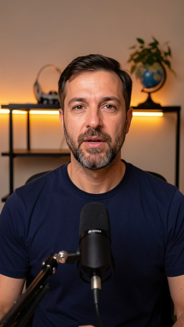

# Exemplos de vídeo curto

Os vídeos finalizados que ficavam nesta pasta nêo fazem parte desta versêo do kit.
No lugar deles, o README principal mostra três fotos simuladas de apresentador,
em `docs/images/`, geradas localmente só para ilustrar o enquadramento 9:16.
Elas nêo retratam pessoas reais.

### Reel de curiosidade: destrave seu projeto

### Reel de curiosidade: construa um sistema de IA melhor

### Anúncio ao vivo

Use as fotos como referência de enquadramento ao planejar seus próprios ganchos,
legendas, ritmo visual e sound design. Os projetos-fonte editáveis desses exemplos
nêo estêo incluídos. Traga suas próprias gravações para os exercícios de ediçêo.
